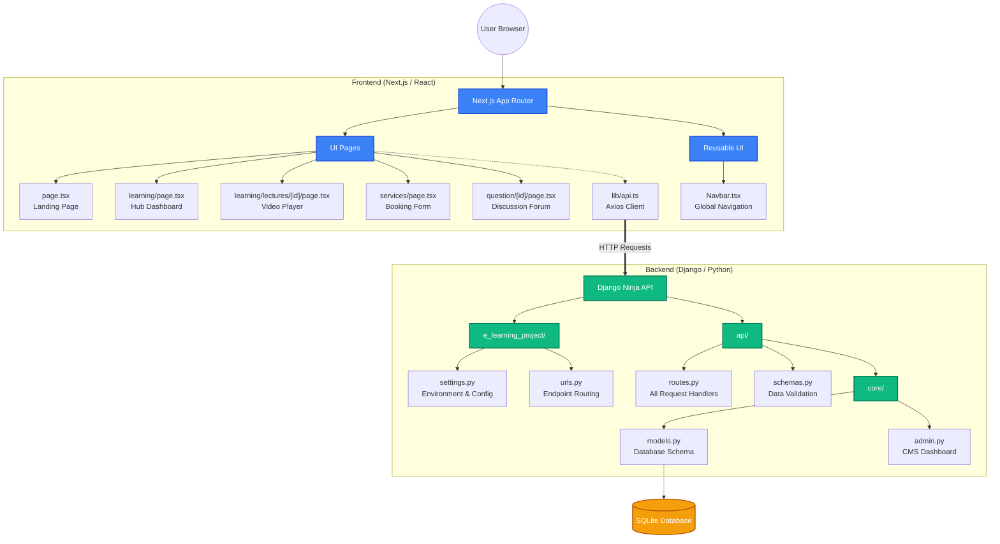
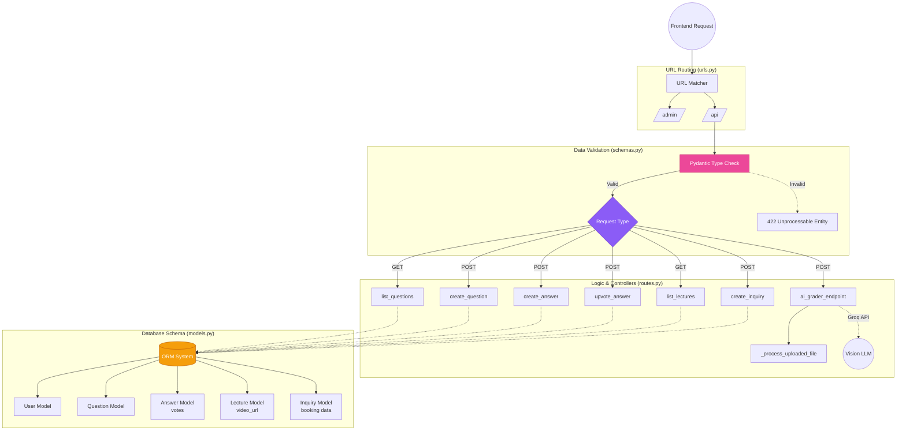

# Project Flowcharts & Architecture

Here are the high-level diagrams that explain the structure and flow of the `NeuralSpark` platform. You can use these in your college presentation.

## 1. Project Architecture & File Structure

This flowchart explains the core files and what their purpose is across the Next.js frontend and Django backend.

## 2. Backend Data Flow & Functions

This flowchart breaks down the internal functions inside `routes.py`, `models.py`, and how they handle incoming HTTP requests (like creating a question or upvoting an answer).

