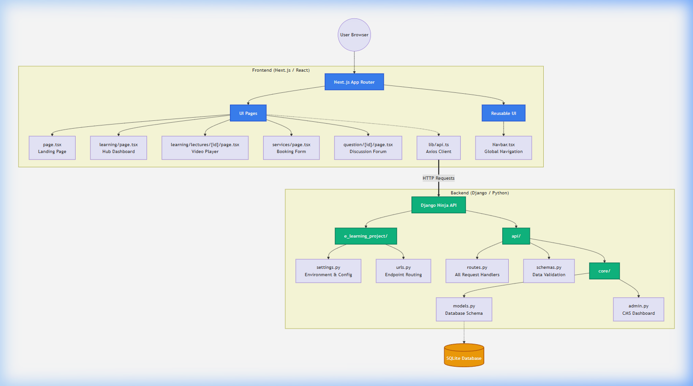
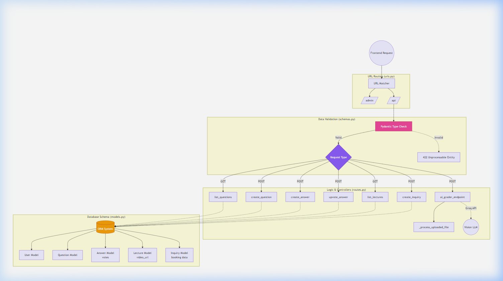
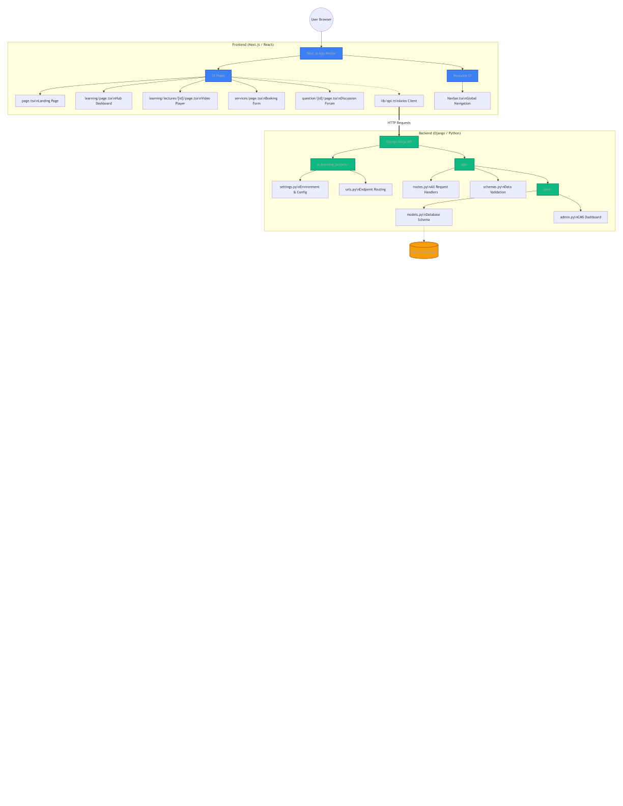
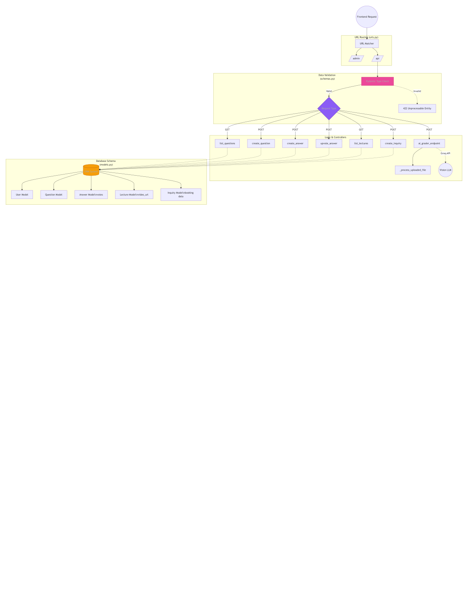
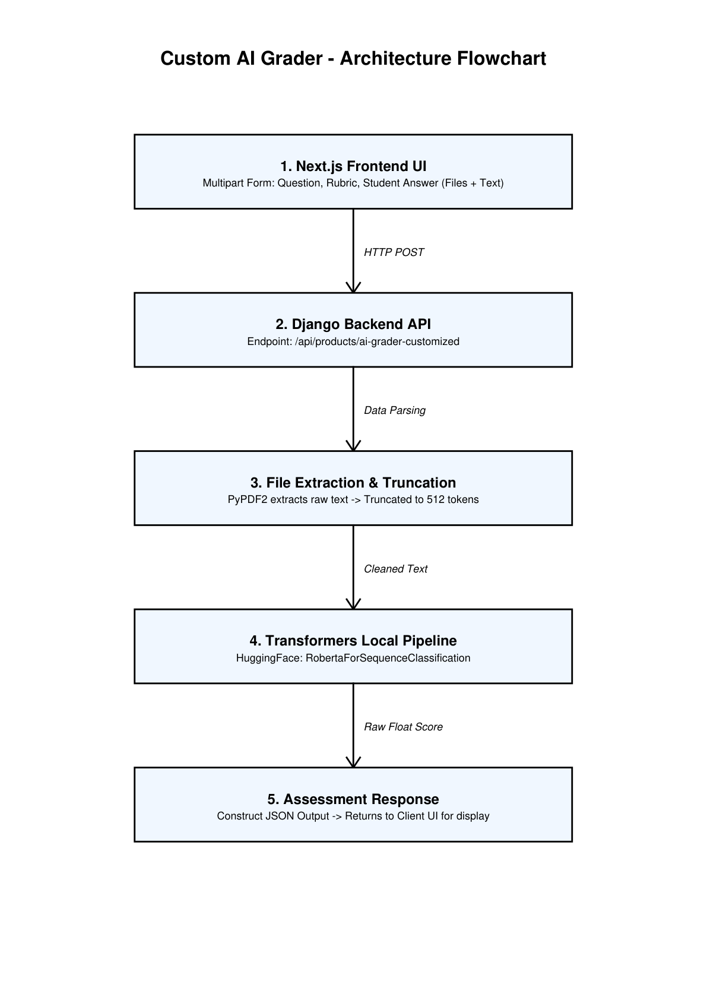

# NeuralSpark: Technical Reference Summary
## Function & Class Usage Guide (v1.0)

---

### 1. Executive Summary
NeuralSpark is a full-stack AI-powered e-learning platform built with Django 6 and Next.js 16. This summary document provides a concise reference of every major class, function, and hook in the project — including their purpose and usage — without exposing raw source code.

---

### 2. Diagram 1 - High-Level Project Architecture

---

### 3. Diagram 2 - Backend Data Flow

---

### 4. Diagram 3 - NeuralSpark Full System Architecture

---

### 5. Diagram 4 - NeuralSpark Backend Flow (Detailed)

---

### 6. Diagram 5 - Custom AI Grader Architecture

---

### 7. Database Models Reference (backend/core/models.py)
All models inherit from Django's base Model class (or AbstractUser for the User model). They are managed via the Django ORM and automatically map to relational database tables.

CLASS: User (extends AbstractUser)
  Fields: bio (TextField), reputation (IntegerField)
  Purpose: Custom user model. The reputation field enables a gamified scoring system for community contributions.

CLASS: Tag (extends Model)
  Fields: name (CharField, unique), description (TextField)
  Purpose: Lightweight tagging system. Questions are linked to multiple Tags via a ManyToManyField for filtering and discovery.

CLASS: Category (extends Model)
  Fields: name (CharField, unique), description (TextField)
  Purpose: High-level subject classification (e.g. Data Structures). Used as a foreign key by Lecture, PYQ, and Question models.

CLASS: Lecture (extends Model)
  Fields: title, description, video_url, category (FK), order (IntegerField), created_at
  Purpose: Represents a single video lecture unit. The order field enables chapter sequencing by instructors.

CLASS: PYQ (extends Model)
  Fields: year, subject (FK to Category), question_text, answer_text, video_url, created_at
  Purpose: Stores Previous Year Questions for competitive exam preparation with optional video explanations.

CLASS: Product (extends Model)
  Fields: name, description, price (DecimalField), image_url, purchase_link, created_at
  Purpose: Marketplace items (e.g. mock tests, books). Includes an external purchase_link for third-party checkout flows.

CLASS: Service (extends Model)
  Fields: name, description, price, image_url, contact_link, created_at
  Purpose: Premium service listings (e.g. 1-on-1 mentorship). Linked to Inquiry objects for lead tracking.

CLASS: Question (extends Model)
  Fields: author (FK), title, body, video_url, is_video_approved, tags (M2M), category (FK), created_at, views, votes
  Purpose: Core model for the Community Q&A Forum. View count auto-increments on each fetch; video requires admin approval before display.

CLASS: Answer (extends Model)
  Fields: author (FK), question (FK), body, is_approved (BooleanField), created_at, votes
  Purpose: Community answer linked to a Question. Requires moderator approval before it becomes publicly visible.

CLASS: Comment (extends Model)
  Fields: author (FK), body, created_at, question (FK, nullable), answer (FK, nullable)
  Purpose: Flexible comment that can be attached to either a Question or an Answer.

CLASS: Inquiry (extends Model)
  Fields: name, email, service (FK, nullable), message, created_at
  Purpose: Captures contact form submissions from the Services page. Generates CRM leads for premium service bookings.

---

### 8. API Schemas Reference (backend/api/schemas.py)
Schemas are Pydantic-powered classes used by Django Ninja for strict request/response validation.

CLASS: CategorySchema (ModelSchema)
  Usage: Serializes Category objects. Used as a nested field in LectureSchema and PYQSchema.

CLASS: LectureSchema (ModelSchema)
  Usage: Formats Lecture data for the frontend video player. Includes nested CategorySchema.

CLASS: PYQSchema (ModelSchema)
  Usage: Formats Previous Year Question data including the subject (Category) as a nested object.

CLASS: ProductSchema (ModelSchema)
  Usage: Serializes Product marketplace items including pricing and external purchase links.

CLASS: ServiceSchema (ModelSchema)
  Usage: Serializes premium service listings for display and inquiry linking.

CLASS: UserSchema (ModelSchema)
  Usage: Safely exposes user data (id, username, reputation, bio). Excludes passwords and sensitive fields.

CLASS: TagSchema (ModelSchema)
  Usage: Serializes Tag objects. Used as a list in QuestionOutSchema for topic labeling.

CLASS: QuestionOutSchema (ModelSchema)
  Usage: Outgoing schema for Question data. Nests UserSchema (author) and a list of TagSchema.

CLASS: QuestionInSchema (Schema)
  Usage: Incoming payload validator for POST /questions/. Accepts title, body, video_url, and a list of tag name strings.

CLASS: AnswerOutSchema (ModelSchema)
  Usage: Outgoing schema for Answer data. Includes nested UserSchema for the author.

CLASS: AnswerInSchema (Schema)
  Usage: Simple incoming schema for submitting a new answer (body field only).

CLASS: CommentOutSchema (ModelSchema)
  Usage: Outgoing schema for Comment data with nested author info.

CLASS: CommentInSchema (Schema)
  Usage: Incoming schema for new comment submissions (body field only).

CLASS: AIGraderInSchema (Schema)
  Usage: (Legacy) Validates text-only grading requests before multimodal file support was added.

CLASS: AIGraderOutSchema (Schema)
  Usage: Returns the evaluation string from the AI grader back to the frontend.

CLASS: InquiryInSchema (Schema)
  Usage: Validates contact form submissions. The optional service_id links the inquiry to a specific service listing.

CLASS: InquiryOutSchema (ModelSchema)
  Usage: Confirms the saved inquiry to the frontend. Includes nested ServiceSchema if a service was linked.

---

### 9. API Route Handlers Reference (backend/api/routes.py)
All handlers are registered on the NinjaAPI instance. Django Ninja automatically generates OpenAPI docs.

FUNCTION: get_current_user()
  Usage: Helper to retrieve or create the default 'testuser'. Used in all creation endpoints as a placeholder for a proper authentication system.

FUNCTION: hello(request)
  Endpoint: GET /hello/
  Usage: Sanity check endpoint. Returns a simple JSON message to confirm the API is up.

FUNCTION: list_questions(request)
  Endpoint: GET /questions/
  Usage: Fetches all community questions from the database. Results are ordered by newest first (-created_at).

FUNCTION: create_question(request, payload)
  Endpoint: POST /questions/
  Usage: Creates a new Q&A forum post. Loops through the payload's tag list and uses get_or_create to prevent duplicates.

FUNCTION: get_question(request, q_id)
  Endpoint: GET /questions/{q_id}/
  Usage: Fetches a single question by its ID. Atomically increments the views counter on every call.

FUNCTION: list_answers(request, q_id)
  Endpoint: GET /questions/{q_id}/answers/
  Usage: Returns only approved answers for a question, sorted by highest votes first.

FUNCTION: create_answer(request, q_id, payload)
  Endpoint: POST /questions/{q_id}/answers/
  Usage: Submits a new answer to a question. The answer is hidden until an admin sets is_approved=True.

FUNCTION: upvote_answer(request, a_id)
  Endpoint: POST /answers/{a_id}/upvote/
  Usage: Increments the vote count on a specific answer by 1.

FUNCTION: downvote_answer(request, a_id)
  Endpoint: POST /answers/{a_id}/downvote/
  Usage: Decrements the vote count on a specific answer by 1.

FUNCTION: create_answer_comment(request, a_id, payload)
  Endpoint: POST /answers/{a_id}/comments/
  Usage: Attaches a comment to a specific answer in the discussion thread.

FUNCTION: list_categories(request)
  Endpoint: GET /categories/
  Usage: Returns all subject categories. Used by the frontend to populate subject filter dropdowns.

FUNCTION: list_lectures(request)
  Endpoint: GET /lectures/
  Usage: Returns all video lectures sorted by the order field, enabling instructors to set chapter sequences.

FUNCTION: list_pyqs(request)
  Endpoint: GET /pyqs/
  Usage: Returns all Previous Year Questions sorted by year (newest first).

FUNCTION: list_products(request)
  Endpoint: GET /products/
  Usage: Returns all marketplace products, sorted by creation date.

FUNCTION: list_services(request)
  Endpoint: GET /services/
  Usage: Returns all available premium services for the Services booking page.

FUNCTION: create_inquiry(request, payload)
  Endpoint: POST /inquiries/
  Usage: Saves a new contact form submission. Optionally links it to a specific service if service_id is provided.

---

### 10. AI Grader Functions Reference (backend/api/routes.py continued)

FUNCTION: _process_uploaded_file(file, label)
  Usage: Private helper for the AI Grader endpoints. Routes uploaded files based on type:
    - PDF files: Extracts text using PyPDF2 and returns it as a text message for the LLM.
    - Image files (PNG/JPG/JPEG/WEBP): Encodes image bytes as a Base64 data URI for the Groq Vision model.

FUNCTION: ai_grader_endpoint(request, question, rubric, student_answer, ...)
  Endpoint: POST /products/ai-grader/
  Usage: Main Groq-powered multimodal grader. Constructs a rich prompt from text inputs and uploaded files, then calls the Groq cloud LLM API. Returns a structured Score/Feedback response.

FUNCTION: get_custom_grader_pipeline()
  Usage: Lazy loader for the local HuggingFace model. The model is only loaded into memory on the first request to the endpoint. Uses a global variable to cache the loaded pipeline across subsequent requests.

FUNCTION: ai_grader_endpoint_customized(request, question, rubric, student_answer, ...)
  Endpoint: POST /products/ai-grader-customized/
  Usage: Local grader using the fine-tuned Transformers model. Only processes text inputs (does not support images). Returns a numeric score from the classification model.

---

### 11. Frontend Hooks & Functions Reference (frontend/src/)

COMPONENT: Home() — app/page.tsx
  Usage: Landing page entry point. Defines animation variants (containerVariants, itemVariants) to stagger the entrance of feature cards. Renders the Hero section and a 5-card feature grid.

COMPONENT: Navbar() — components/Navbar.tsx
  Usage: Global sticky navigation. Uses Framer Motion for a spring-based drop-down entrance animation. Reads theme state from ThemeContext to render the dark/light mode toggle icon.

FUNCTION: ThemeProvider({ children }) — context/ThemeContext.tsx
  Usage: React context provider that wraps the entire app. On mount, reads the saved theme from localStorage or the system preference. Applies/removes the dark CSS class on the HTML root element based on current theme state.

FUNCTION: useTheme() — context/ThemeContext.tsx
  Usage: Custom hook for consuming the ThemeContext. Throws an error if used outside of ThemeProvider, ensuring correct component tree structure.

FUNCTION: toggleTheme() — context/ThemeContext.tsx
  Usage: Toggle function exposed via ThemeContext. Flips the theme state between "light" and "dark" and saves the new value to localStorage for persistence across sessions.

---

### 12. Technology Stack Summary

Backend Stack:
  Django 6.0.2 — Core web framework and ORM
  Django Ninja 1.5.3 — Fast REST API framework
  Pydantic 2.12.5 — Request/response data validation
  Groq SDK 1.0.0 — Cloud LLM inference client
  Transformers — Local AI model inference
  PyPDF2 3.0.1 — PDF text extraction
  fpdf2 2.8.6 — PDF report generation

Frontend Stack:
  Next.js 16.1.6 — Full-stack React framework
  React 19.2.3 — UI component library
  Tailwind CSS 4 — Utility-first styling
  Framer Motion 12 — Animation library
  Lucide React — Icon system
  Axios 1.13.5 — HTTP client

Deployment:
  Vercel — Frontend (Next.js)
  Render.com — Backend (Gunicorn + Django)
  PostgreSQL — Production database

---

### 13. Summary of All API Endpoints

Endpoint | Method | Handler | Description
GET /hello/ | GET | hello | API health check
GET /questions/ | GET | list_questions | List all forum questions
POST /questions/ | POST | create_question | Post a new question
GET /questions/id/ | GET | get_question | View question + increment views
GET /questions/id/answers/ | GET | list_answers | Get approved answers
POST /questions/id/answers/ | POST | create_answer | Submit an answer
POST /answers/id/upvote/ | POST | upvote_answer | Upvote an answer
POST /answers/id/downvote/ | POST | downvote_answer | Downvote an answer
POST /answers/id/comments/ | POST | create_answer_comment | Comment on an answer
GET /categories/ | GET | list_categories | Get all subjects
GET /lectures/ | GET | list_lectures | Get video lectures
GET /pyqs/ | GET | list_pyqs | Get previous year questions
GET /products/ | GET | list_products | Get marketplace products
GET /services/ | GET | list_services | Get premium services
POST /inquiries/ | POST | create_inquiry | Submit service inquiry
POST /products/ai-grader/ | POST | ai_grader_endpoint | Grade with Groq LLM
POST /products/ai-grader-customized/ | POST | ai_grader_endpoint_customized | Grade with local model

---

### 14. Conclusion
This reference document provides a complete, non-source-code view of the NeuralSpark project. Every class, model, schema, function, and hook has been documented with its exact purpose and usage context.

---
*NeuralSpark — Technical Reference Summary | v1.0*
*Companion document to the Full Architecture Report*
